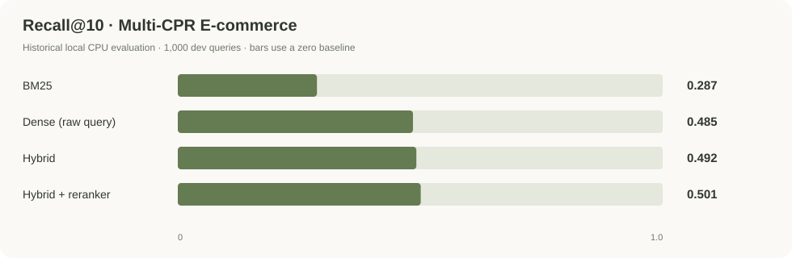

# MiWu · AI Shopping Assistant

**Discover store products through conversation. Make shopping choices with product evidence.**

[中文](README.zh-CN.md) · [Architecture](docs/architecture.md) · [Evaluation](docs/evaluation.md) · [User guide](docs/demo.md) · [Engineering](docs/engineering.md)

MiWu brings conversational product discovery to Shopify. Shoppers can describe their needs, budget and preferences in English or Chinese, explore store products, and follow recommendations to real product pages. Retrieval and an LLM tool-calling Agent connect the conversation to the merchant's catalog.

## Meet Ask MiWu

[Open the demo store](https://miwu-ai-store.myshopify.com/) → click **Ask MiWu** → try `Help me find a snowboard`.

*A warm, restrained sidebar with real product images, snapshot prices and same-store links. The merchant's storefront stays at the center of the experience.*

## Capabilities

| Capability | Experience |
| --- | --- |
| Conversational discovery | Describe a shopping need and explore catalog products |
| English and Chinese input | Use either language in an English storefront; replies aim to follow the shopper's language |
| Constraint-aware suggestions | Request budget-compatible options and receive explicit uncertainty when facts are missing |
| Details and comparison | Agent tools support search, details and comparison; complex comparison completion remains under development |
| Real product cards | View product images, names, snapshot prices and storefront links |
| Evidence-constrained answers | Validate product identity and answer evidence, with verified-fact fallback when needed |

### Missing information stays visible

*Asked for a blue snowboard under $750, MiWu explains in Chinese that color cannot be confirmed from the catalog and presents budget-compatible alternatives. This demonstrates uncertainty handling, not image-based color recognition or exhaustive cheapest-product ranking.*

## Architecture

Shopify Admin GraphQL → product adapter → unified product schema → retrieval/reranking → Agent tools → evidence checks → FastAPI → signed App Proxy → Theme App Extension.

A unified product contract connects merchant data to the shopping core. Sparse and dense retrieval combine lexical and semantic matching; reranking refines the candidate order. The Agent selects catalog tools under a bounded call budget. Before rendering cards, the sidebar verifies product identity and storefront visibility. [Component responsibilities and trust boundaries](docs/architecture.md).

## Recorded results

Validation covers two distinct execution profiles:

| Track | Recorded evidence |
| --- | --- |
| **Million-scale offline retrieval** | 1,002,822 Multi-CPR E-commerce passages; 1,000 dev queries |
| **Shopify cloud MVP** | 17 test products read; 15 indexed; real storefront integration |

The small cloud catalog does not demonstrate million-product production serving. Offline BGE/Qwen results and API-backed cloud behavior are measured separately.

| Retrieval method | Recall@10 | MRR@10 |
| --- | ---: | ---: |
| BM25 | 0.287 | 0.161193 |
| Dense | 0.485 | 0.292127 |
| Hybrid | 0.492 | 0.297857 |
| Hybrid + reranker | **0.501** | **0.314564** |

Hybrid + reranking improves Recall@10 by **21.4 percentage points** over BM25. Reranking adds **0.9 points** over hybrid and improves MRR@10 by **5.61% relatively**, within a top-20 candidate pool.

Historical local Agent evaluation across 40 cases recorded **82.5% tool-selection accuracy** and **75% reference-resolution accuracy**. These are not cloud answer-accuracy or universal factuality measures. [Definitions, denominators and limitations](docs/evaluation.md) · [Numeric results](metrics/evaluation.json).

## Engineering

- **Platform adaptation:** separate the merchant-data adapter, retrieval/Agent core and storefront transport through a unified product contract.
- **Resource control:** memory-mapped float16 vectors and blockwise exact search support offline evaluation; hosted model APIs support the small cloud deployment.
- **Trust boundaries:** validate tool arguments, product identity, limited factual evidence and storefront visibility before displaying results.
- **Independent serving:** FastAPI, HTTPS, Nginx and systemd support deployment alongside an existing application on a 2-vCPU / 2-GB-class ECS instance.
- **Storefront integration:** a compact homepage entry and sidebar keep conversational discovery accessible within the shopping experience.

**Stack:** Python · FastAPI · LangChain native tool calling · BM25 · BGE dense retrieval/reranker (offline) · Qwen/Ollama (local) · hosted model APIs (cloud) · Shopify Admin GraphQL/App Proxy/Theme App Extension · Ubuntu ECS · Nginx · systemd · HTTPS.

## Status and scope

MiWu is a single-store MVP. Prices are synchronization snapshots; product pages are authoritative for current prices and availability. Complex comparisons can fall back to a verified fact list without completing the requested comparison. Constraint satisfaction and comparison completion remain improvement areas.

Multi-merchant onboarding, large-scale load testing, automated catalog synchronization and conversion measurement have not been validated. Initial integration acceptance and the original sidebar screenshot were recorded on **2026-10-03**; the bilingual example was captured during user testing on **2026-10-08**.

The demo store may require access authorization. Recorded examples are available in the [user guide](docs/demo.md).

This repository provides product documentation, architecture and selected evaluation results. The complete implementation, prompts, business logic and operational configuration remain private; a runnable backend is not distributed here. [Content scope and attribution](NOTICE.md).
