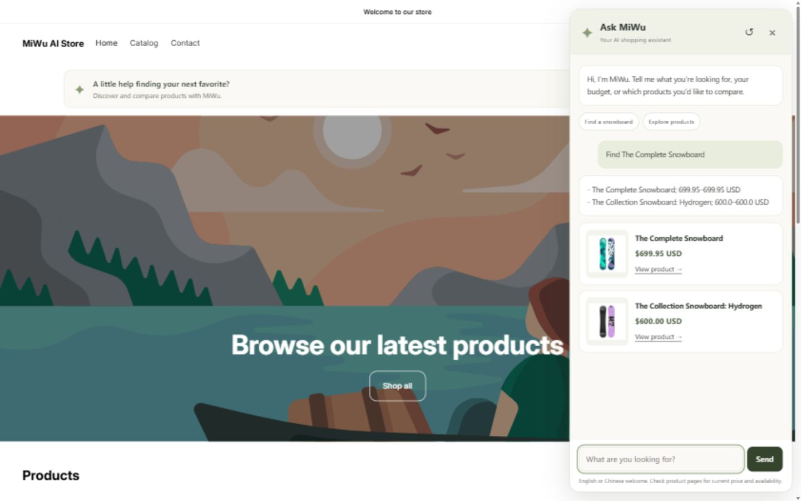
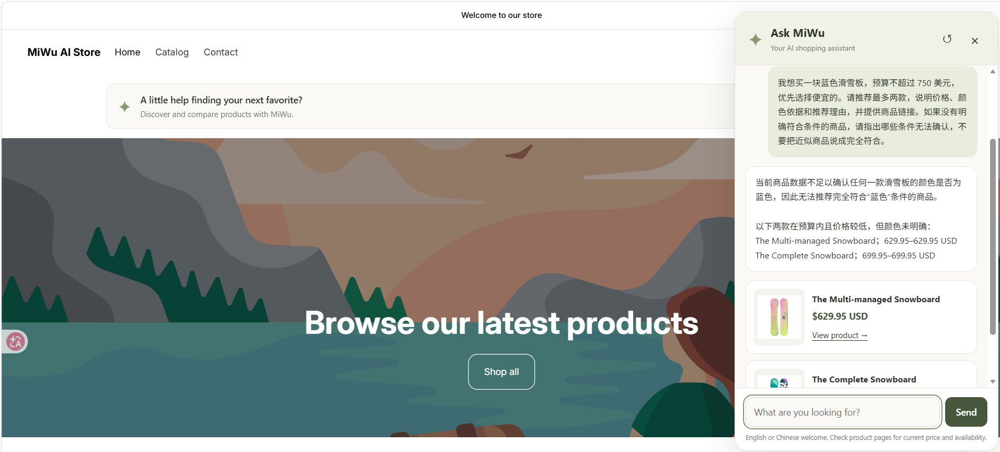
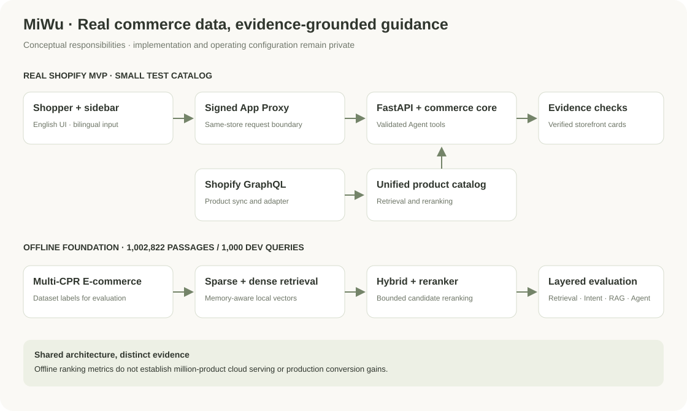

# 觅物 MiWu · AI 智能导购

**用自然语言发现店内商品，让购物选择更简单。**

[English](README.md) · [系统架构](docs/architecture.md) · [评测结果](docs/evaluation.md) · [使用指南](docs/demo.md) · [工程设计](docs/engineering.md)

MiWu 是可嵌入 Shopify 商店的 AI Shopping Assistant。用户可以用中文或英文表达需求、预算和偏好，MiWu 结合店内商品数据与检索结果提供导购回答，并通过商品卡片连接到真实商品页面。

## 在商店中使用 Ask MiWu

打开[MiWu 演示商店](https://miwu-ai-store.myshopify.com/)，点击首页入口或浮动按钮 **Ask MiWu**，输入 `Help me find a snowboard`，即可开始探索商品。

温和的配色、清晰的商品卡片和侧边栏交互，让 AI 导购自然融入商店。商店页面始终是购物体验的主体。

## 核心能力

| 能力 | 使用体验 |
| --- | --- |
| 自然语言商品发现 | 直接描述需求，获取店内商品及相关信息 |
| 中英文交互 | 英文界面支持中英文输入，并尽量使用用户的语言回答 |
| 条件筛选 | 根据预算和商品证据提供备选，明确说明无法确认的条件 |
| 商品详情与比较 | Agent 提供搜索、详情和比较工具；复杂比较仍在持续优化 |
| 真实商品卡片 | 展示商品图片、名称、价格快照和店内商品链接 |
| 证据约束 | 校验商品身份与回答依据，必要时返回已验证的商品事实 |

### 看得见的证据边界

用户提出“蓝色、750 美元以内”的需求时，MiWu 用中文说明商品数据无法确认颜色，并提供预算内的备选商品及链接。该案例体现对缺失信息的处理；不代表图片颜色识别或全店最低价排序。

## 系统架构

Shopify Admin GraphQL → ShopifyProductAdapter → Unified Product Schema → 检索与重排 → Agent 工具 → 证据校验 → FastAPI → App Proxy → Theme App Extension。

统一商品契约连接 Shopify 商品与导购核心；混合检索结合关键词和语义匹配，重排优化候选顺序；Agent 根据请求调用商品工具，前端验证商品可见性后展示卡片。详见[系统架构与信任边界](docs/architecture.md)。

## 验证结果

MiWu 的验证分为两个独立范围：

| 范围 | 已记录的验证 |
| --- | --- |
| 百万级离线检索 | Multi-CPR 电商语料：1,002,822 条 passage、1,000 条 dev query |
| Shopify 云端 MVP | 读取 17 个测试商品、15 个参与检索，完成真实商店端到端接入 |

| 检索方法 | Recall@10 | MRR@10 |
| --- | ---: | ---: |
| BM25 | 0.287 | 0.161193 |
| Dense | 0.485 | 0.292127 |
| Hybrid | 0.492 | 0.297857 |
| Hybrid + Reranker | **0.501** | **0.314564** |

混合检索加重排的 Recall@10 相比 BM25 提升 **21.4 个百分点**。历史 40 案例本地 Agent 评测的工具选择准确率为 **82.5%**，商品引用解析准确率为 **75%**。这些结果不等同于云端回答准确率，也不代表百万商品生产部署。完整定义、分母和已知失败见[评测说明](docs/evaluation.md)。

## 工程设计

- **平台适配：**将商品数据、检索核心和商店交互分离，便于维护不同的数据来源与运行环境。
- **资源控制：**离线检索采用内存映射与分块搜索；小规格云端部署使用托管模型 API。
- **可信展示：**工具参数、商品身份、证据依据与店铺可见性分层校验。
- **独立部署：**FastAPI、HTTPS、Nginx 和 systemd 支持与已有应用共用服务器。

**技术栈：**Python · FastAPI · LangChain Tool Calling · BM25 · BGE Dense / Reranker（离线）· Qwen / Ollama（本地）· 托管模型 API（云端）· Shopify Admin GraphQL / App Proxy / Theme App Extension。

## 当前状态

当前为单店铺 MVP。商品价格来自同步快照，实时价格和库存以商品页为准。复杂比较可能返回商品事实列表，条件满足度和比较完成度仍需优化；尚未完成多商户接入、大规模并发、自动同步及转化效果验证。

演示商店可能需要访问授权；如无法进入，可参阅[使用指南与运行截图](docs/demo.md)。初始接入验收与侧边栏截图记录于 2026-10-03，中文条件筛选截图记录于 2026-10-08。

本仓库提供 MiWu 产品介绍、系统架构与评测资料。完整实现、提示词、业务逻辑及部署配置保持私有；本仓库不包含可运行的后端源码。详见[内容范围与素材说明](NOTICE.md)。
